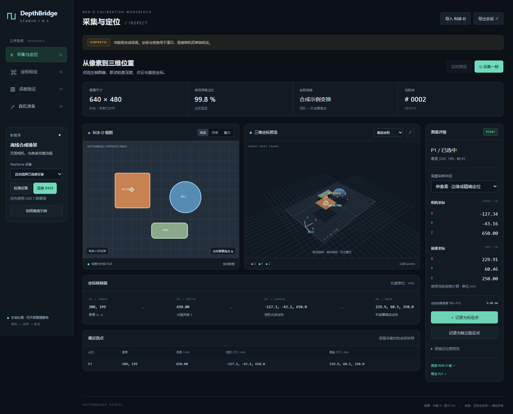
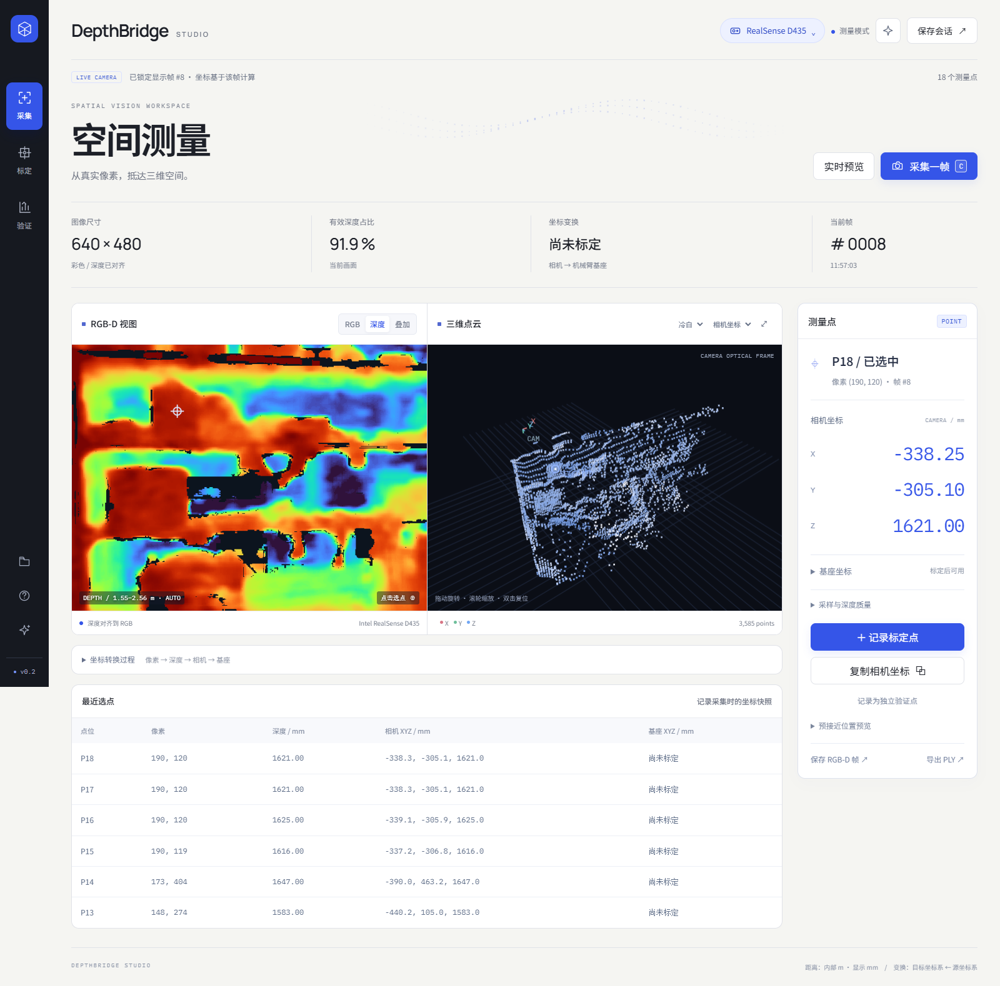
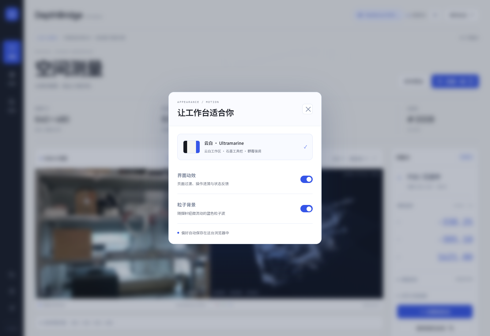
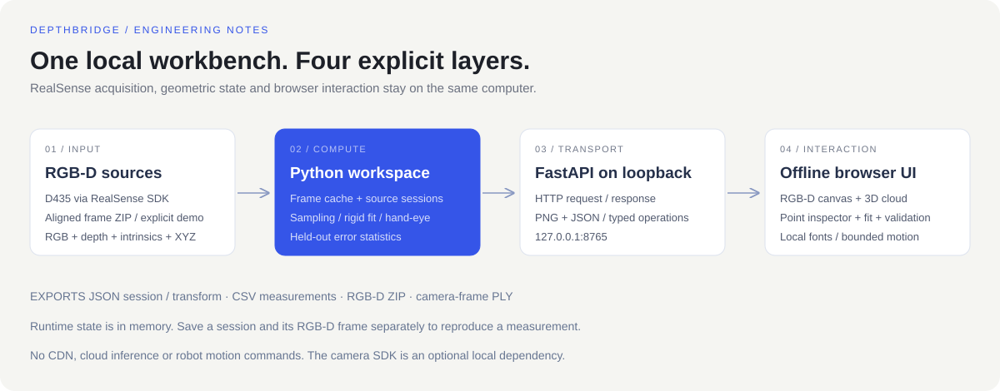
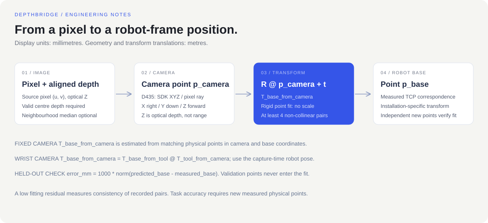
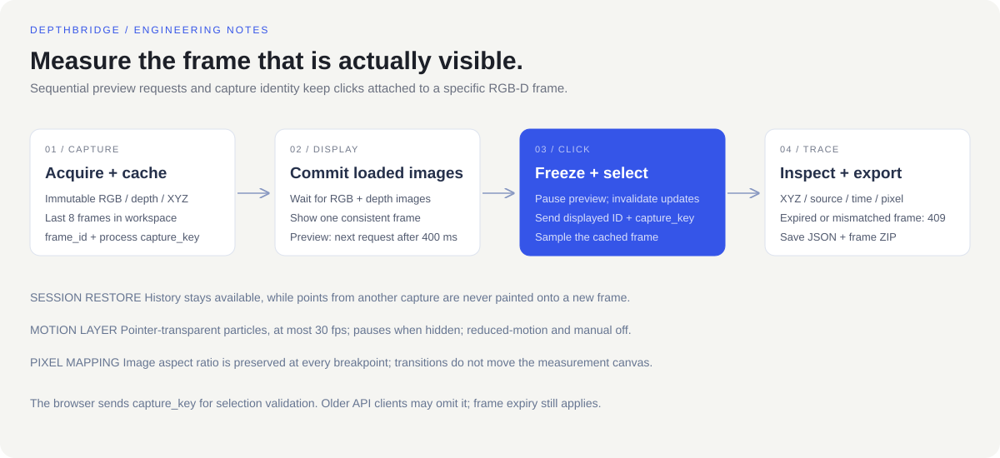
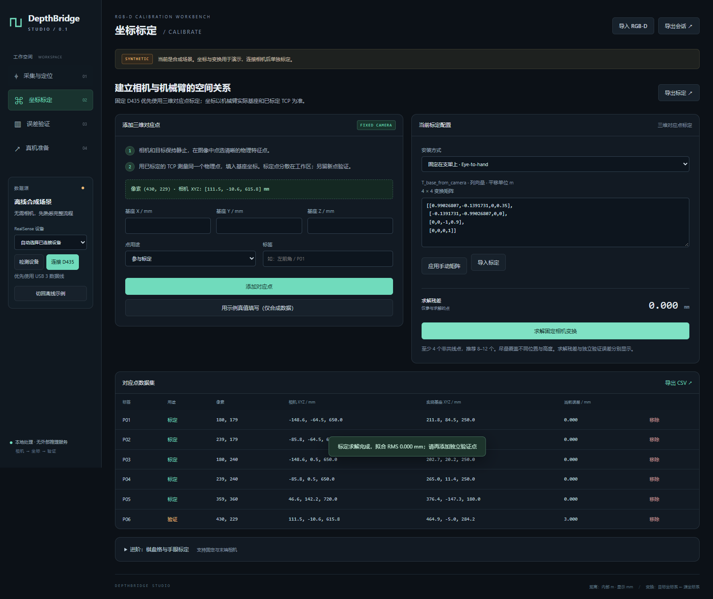
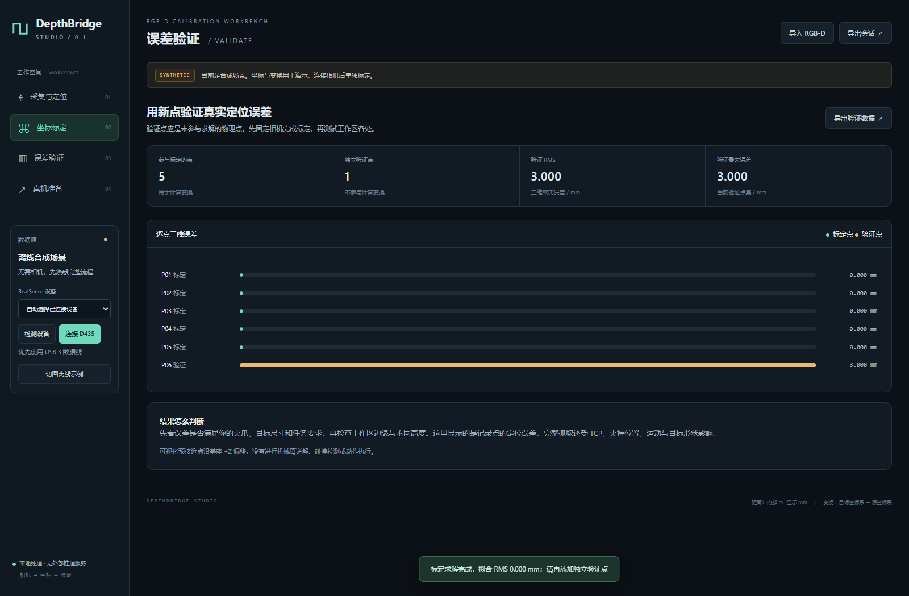

<div align="center">

# DepthBridge Studio

### 从真实像素，抵达三维空间。

本地 RGB-D 测量与标定工作台 · Intel RealSense D435 优先

[](https://github.com/XiaoMa-77/depthbridge-studio/actions/workflows/ci.yml)


[快速开始](#快速开始) · [使用流程](#使用流程) · [系统架构](#系统架构) · [设计文档](DESIGN.md) · [实测记录](docs/D435_相机实测记录.md) · [更新日志](CHANGELOG.md)

</div>



<p align="center"><sub>0.2 实际运行截图，固定 D435 采集。基座坐标保持未标定；画面中的 XYZ 来自该帧的真实深度。</sub></p>

DepthBridge 将 RGB-D 采集、像素选点、三维查看、相机与机械臂坐标标定、独立误差验证放进一个浏览器工作台。适用于固定相机安装检查、桌面测距、标定过程复核和 RGB-D 数据复现。程序在本机运行，界面、字体、点云渲染与几何计算均无需外部服务。

## 0.2 的工作台

**云白背景、石墨工具栏、群青交互。** 采集、标定、验证组成三步主流程，RGB-D 与点云并排展示，大号等宽 XYZ 放在独立测量面板。设备入口位于顶部；数据导入、示例和帮助按需打开。启动时等待设备，合成示例由用户明确开启。

标题区的蓝色粒子波随指针产生轻微响应，页面切换、弹窗、按钮涟漪、采集和连接状态提供动态反馈。动效与粒子可分别关闭，偏好保存在当前浏览器；系统减少动态效果时自动停用动效。粒子层不拦截图像点击，后台页面暂停粒子渲染，最高 30 fps。点云可切换冷白与原色显示，原始 RGB、XYZ 和 PLY 导出不受影响。

<details>
<summary>查看深度显示与外观设置</summary>





</details>

## 快速开始

推荐 **Python 3.12 x64**。Windows PowerShell 中执行：

```powershell
.\setup.ps1
.\start.ps1
```

打开 **http://127.0.0.1:8765**，点击右上角“连接相机”。通过 USB 3 接入 D435，选择设备，再点击“连接 D435”。相机首次连接不会继承示例变换。

已有环境可直接启动或检测设备：

```powershell
.\.venv\Scripts\python.exe -m depthbridge
.\.venv\Scripts\python.exe -m depthbridge --devices
```

手动安装：

```bash
python3.12 -m venv .venv
# Windows 将下面的 .venv/bin/python 替换为 .venv\Scripts\python.exe
.venv/bin/python -m pip install -e ".[realsense]"
.venv/bin/python -m depthbridge
```

无相机时安装 `pip install -e .`，从工具栏的“数据与示例”打开合成场景，或导入 RGB-D ZIP。RealSense SDK 为可选扩展。使用 `--port 8766` 更换端口，`--no-browser` 关闭自动打开浏览器；PyCharm 选择项目 `.venv` 解释器并运行 `main.py`。PowerShell 限制脚本执行时，可在当前终端执行 `powershell -ExecutionPolicy Bypass -File .\setup.ps1`，启动脚本同理。

## 使用流程

| 步骤 | 操作 | 得到什么 |
|---|---|---|
| **01 · 采集与测量** | 连接 D435，实时预览或采集一帧；点击目标像素 | 冻结显示帧，查看光轴深度、相机 XYZ、邻域深度质量和联动点云 |
| **02 · 坐标标定** | 记录同一物理点的相机坐标与实测 TCP 基座坐标 | 刚体变换 `T_base_from_camera`、拟合残差及逐点记录 |
| **03 · 独立验证** | 使用未参与标定的新物理点，填写实测基座坐标 | 三维欧氏误差、RMS、最大误差及 CSV |
| **04 · 保存复现** | 保存会话 JSON，另存当前 RGB-D ZIP | 可追溯的点位、源帧、时间、变换快照和原始图像 |

固定相机标定至少需要 **4 个非共线对应点**，建议 8–12 点覆盖工作区并包含不同高度。相机与目标保持静止；相机所见的表面特征必须与 TCP 测量的物理点一致。完整步骤见 [D435 验收指南](docs/D435_验收指南.md)。

默认使用 5×5 邻域有效深度中值，边缘或精确特征可在“采样与深度质量”将半径设为 0。中心像素无有效深度时拒绝测量。深度颜色按当前帧有效值的 2%–98% 分位自适应，图像注明范围；着色范围不会截断实际读数。

快捷键：`Space` 实时预览／暂停，`C` 采集一帧，`?` 打开帮助，`Esc` 关闭辅助面板。

## 系统架构



| 层 | 实现 | 职责 |
|---|---|---|
| 相机与记录 | `cameras.py` / `frames.py` | SDK 对齐采集、XYZ 点图、RGB-D 文件编解码、自适应深度着色 |
| 几何与状态 | `geometry.py` / `workspace.py` | 像素采样、刚体拟合、手眼求解、独立验证、按数据源隔离会话 |
| 本地 API | `app.py` | FastAPI HTTP 接口、帧与测量请求、数据导出 |
| 交互与渲染 | `static/` | 原生 JavaScript、Canvas 图像与点云、离线字体、可控粒子与界面动效 |

数据流使用 HTTP 请求与响应。实时预览逐次采集，完成后等待 400 ms 再请求下一帧；实际刷新速度取决于采集、编码与渲染耗时。无需前端构建服务、CDN、WebGL 或云端推理。

### 坐标转换机制



```text
p_base = R @ p_camera + t
T_base_from_camera = [[R, t], [0, 0, 0, 1]]
```

- 内部几何、JSON 和矩阵平移使用 **m**；页面实测坐标、深度与误差使用 **mm**。
- 相机光学坐标：X 向右、Y 向下、Z 向前。深度 Z 是光轴分量，相机到点的直线距离为 `norm(XYZ)`。
- 矩阵采用列向量语义，`T_目标_from_来源` 明确转换方向。拟合不引入缩放，也不自动删除异常点。
- D435 使用 SDK XYZ 点图；邻域中值沿点击像素射线取点。没有 XYZ 点图的导入文件仅支持已实现的无畸变／OpenCV Brown 模型。
- 末端相机使用 `T_base_from_tool @ T_tool_from_camera`。历史测量保存采集时机器人位姿；进阶区域提供棋盘格 PnP 与两种安装方式的 Park 手眼求解。

### 显示帧与测量的一致性



浏览器等待 RGB 和深度图加载后提交同一帧。点击时暂停预览、废弃尚未提交的刷新，并将显示帧的 `frame_id` 与 `capture_key` 一起发送。服务端从最多 8 帧的缓存中采样，帧已过期或标识不符时返回 409。恢复会话后的历史点不会覆盖到另一帧画面上。

## 标定与验证界面

以下两张为**合成数据演示**：5 个点参与拟合，第 6 个独立验证点人为加入 3 mm 的 X 偏移，验证误差显示 3 mm。它说明验证点与拟合分离，不代表实物定位精度。





## 数据与设备

| 文件 | 内容 |
|---|---|
| RGB-D ZIP | `color.png`、`depth.npy`、`metadata.json`，真实 SDK 帧附 `points.npy` |
| 会话 JSON | 选点、采集时间、来源、变换快照、实测对应点、手眼观测与参数 |
| 标定 JSON | 变换矩阵、方向、单位、设备来源与质量摘要 |
| CSV | 对应点、用途、坐标与当前变换下的误差 |
| PLY | 相机光学坐标系中的降采样原色点云，单位 m |

格式约定与限制见 [数据格式](docs/数据格式.md)。每个数据源拥有独立的**进程内会话**：真实设备按序列号，文件按内容区分。断开设备保留本进程中的会话；退出进程前请导出。恢复时先连接原设备或导入原帧，再恢复会话 JSON；图像单独保存，移动相机安装位置后重新标定。

实时驱动当前适配 RealSense。Orbbec Astra 可通过规范 RGB-D ZIP 导入记录；具体 Astra 型号的实时采集需另行适配。预接近位置沿基座 +Z 显示高度偏移，程序不执行机械臂动作、逆解或碰撞检测。

## 验证与实测范围

**本地回归：45 项测试通过，Python 语句覆盖率 89%。** 浏览器流程覆盖 RGB／深度／叠加、选点、坐标联动、刚体求解、独立验证、导出与文件隔离，并检查 1280／900／390 px 布局、像素映射、字体、粒子动画、偏好持久化和减少动态效果。见 [测试记录](docs/测试记录.md)。

固定 D435 已通过实际 RGB-D 采集、连续预览、显示帧冻结选点、SDK 坐标与帧导出检查。30 帧重复采样的场景有效深度平均占比为 91.53%；不同采样位置的时间波动见 [相机实测记录](docs/D435_相机实测记录.md)。绝对测距误差与机械臂基座定位精度仍需已知距离和实测物理点验证。

```powershell
.\.venv\Scripts\python.exe -m pip install -e ".[dev,realsense]"
.\.venv\Scripts\python.exe -m pytest --cov=depthbridge --cov-report=term-missing
.\.venv\Scripts\python.exe -m ruff check src tests scripts
.\.venv\Scripts\python.exe scripts/verify_browser.py
.\.venv\Scripts\python.exe -m build
.\.venv\Scripts\python.exe scripts/check_distribution.py
```

本地一键离线校验运行 `bash scripts/verify.sh`，串联 pytest、ruff、编译检查与发行包检查，不访问相机或外部服务；加 `--browser` 可追加浏览器流程。完整设计总览见 [DESIGN.md](DESIGN.md)。

浏览器检查使用独立临时服务并清理进程，不切换正在使用的相机。Linux 首次运行需 `python -m playwright install --with-deps chromium`；Windows 可使用本机 Edge。CI 覆盖 Windows／Linux 的 Python 3.11、3.12 以及 Linux 浏览器流程，硬件检查单独进行。

连接真实 D435 后运行 `scripts/probe_camera.py --frames 30` 与 `scripts/check_live_camera_ui.py`，原始数据默认保存在 Git 忽略的 `data/`。工程图可用 `python scripts/render_diagrams.py` 重新生成，SVG 保持可编辑。

## 技术与许可

- [RealSense SDK](https://github.com/realsenseai/librealsense) · [深度对齐示例](https://github.com/realsenseai/librealsense/blob/master/wrappers/python/examples/align-depth2color.py)
- [OpenCV 标定与手眼求解](https://docs.opencv.org/4.x/d9/d0c/group__calib3d.html)
- UI 字体基于 [Noto Sans SC](https://github.com/google/fonts/tree/main/ofl/notosanssc)、[Manrope](https://github.com/google/fonts/tree/main/ofl/manrope) 和 [IBM Plex Mono](https://github.com/google/fonts/tree/main/ofl/ibmplexmono)，以 OFL 许可离线分发修改后的子集；许可随字体保留。

项目代码使用 [MIT License](LICENSE)。界面设计要求记录在 [UI 设计规范](docs/UI设计规范.md)。
